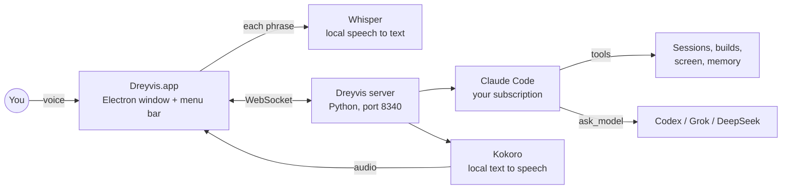

# Dreyvis

**A voice assistant for your Mac that runs on the Claude subscription you already pay for.**


[Try the orb live](https://dreydrey9000.github.io/dreyvis/orb/)

You talk, Dreyvis answers out loud. It can check on your Claude Code sessions, start builds, read your screen, remember things, and hand a question to Codex, Grok or DeepSeek when you want a second opinion.

Dreyvis is Drey Thomas's version of [JARVIS by Ethan Rogers](https://github.com/ethanplusai/jarvis). It adds:

- **Its own Mac app.** A window, a menu-bar switch to turn it on and off, and Option+Space to mute the mic.
- **Free local voice.** Kokoro speaks, so no Fish Audio key is needed.
- **Free local ears.** Whisper on Apple Silicon hears you, so no Chrome is needed.
- **Other AIs on call.** "Ask Codex…", "What does Grok think…", "Ask DeepSeek…". Grok runs in a macOS sandbox.
- **Your apps through Composio.** Gmail, Calendar, Drive, Slack and 1,000 more with two tools. Anything that sends or changes something waits for your spoken yes.
- **Ethan's full dashboard inside the app.** Every run and session, his memory and how much of your plan is left, one click from the orb (Cmd+2).

## How it fits together



Editable copy: [docs/diagrams/dreyvis.mmd](docs/diagrams/dreyvis.mmd).

## What you need

- A Mac with Apple Silicon
- [Claude Code](https://docs.claude.com/en/docs/claude-code), installed and logged in with `claude auth login`
- Python 3.12 and Node.js 22 or newer
- Optional: the `codex` and `grok` command-line tools, logged in, and a `DEEPSEEK_API_KEY` in `~/.codex/.env`

## Set it up

```bash
git clone https://github.com/Dreydrey9000/dreyvis.git && cd dreyvis
cp .env.example .env                       # then fill in the three paths it asks for
python3.12 -m venv .venv && .venv/bin/pip install -r requirements.txt
python3.12 -m venv .venv-ears && .venv-ears/bin/pip install mlx-whisper "numpy<2.5"
(cd frontend && npm install && npm run build)
(cd desktop && npm install && ./build-app.sh)   # installs ~/Applications/Dreyvis.app
```

To run the server in the background and start it at login, copy `docs/com.drey.dreyvis.plist` into `~/Library/LaunchAgents`, change the paths in it, then open Dreyvis.app. The app's menu-bar switch turns that service on and off.

## Using it

| Do this | To |
|---|---|
| Open Dreyvis.app | Show the orb and start talking |
| Menu bar, **Turn off** | Stop the server so it uses no memory |
| **Option+Space** | Mute or unmute the mic, for when music is playing |
| Say "ask Grok…" | Get Grok's answer, read out by Dreyvis |
| Open the dashboard from the menu | See every run, session and how much of your plan is used |

## Costs

- Claude: your subscription. No API key is used.
- Voice and ears: free, both run on your Mac.
- Codex and Grok: your own plans.
- DeepSeek: a small charge for each question, billed to your DeepSeek key.

## Credit and license

Built on JARVIS, copyright (c) 2026 Ethan Rogers. It is shared under his license in [LICENSE](LICENSE), which allows personal, non-commercial use only. You may use and change Dreyvis for yourself and give it away free. You may not sell it or use it in a paid product without a commercial license from [ethanplus.ai](https://ethanplus.ai). Ethan's original README is kept at [docs/UPSTREAM-README.md](docs/UPSTREAM-README.md).
